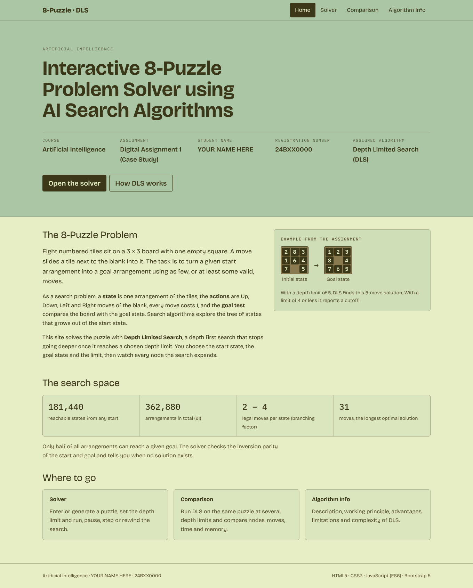
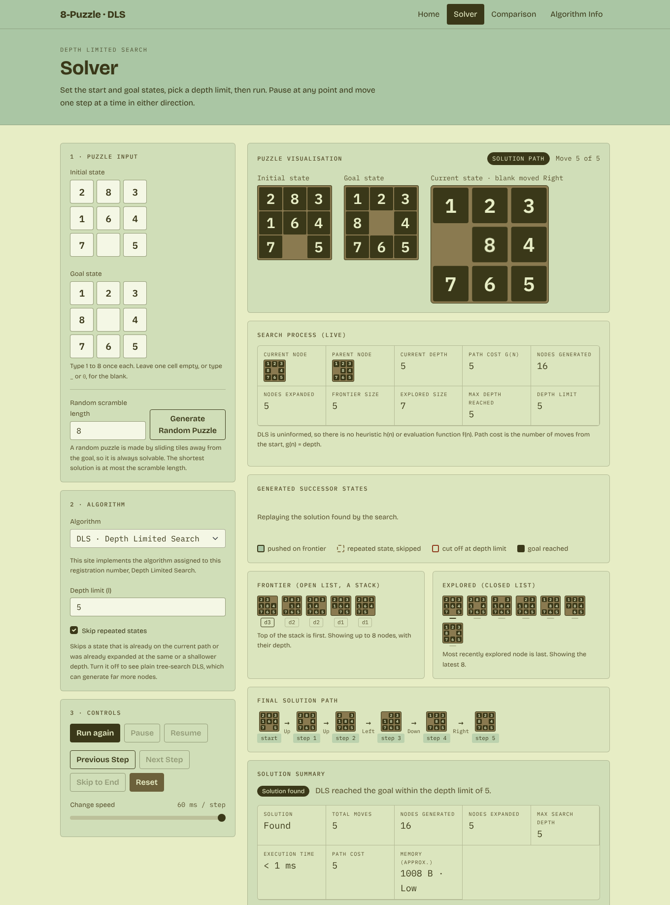
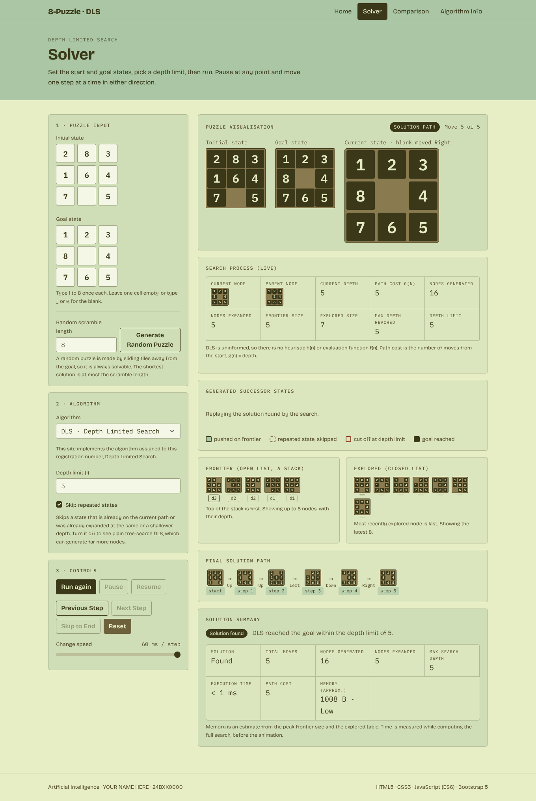
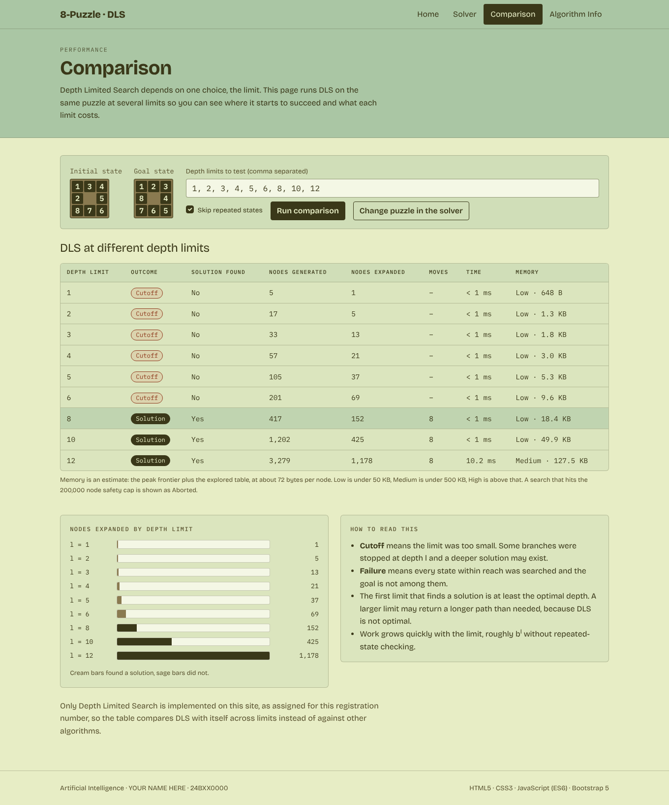
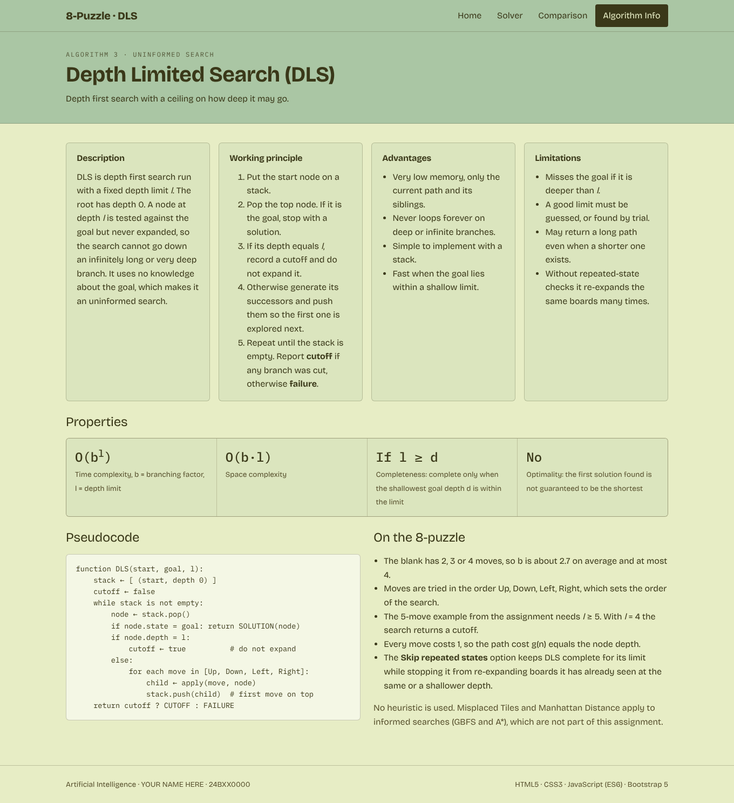

# 8Puzzle-Visualizer

Interactive 8-Puzzle solver that visualises **Depth Limited Search (DLS)**.
Digital Assignment 1 (Case Study), Artificial Intelligence.

**Live site:** https://Lak06.github.io/8Puzzle-Visualizer/
**Repository:** https://github.com/Lak06/8Puzzle-Visualizer

## Project description

A web app that models the 8-puzzle as a state-space search problem and solves it with Depth Limited Search, written from scratch in JavaScript. You enter or generate a puzzle, choose a depth limit, and watch the search expand nodes, push successors on the frontier, cut branches at the limit and finally replay the solution path with the blank tile animated.

The algorithm implemented is the one assigned to this registration number: **Algorithm 3, Depth Limited Search (DLS)**.

## Technologies used

- HTML5, CSS3, JavaScript (ES6), no build step
- Bootstrap 5.3.3 (vendored in `assets/vendor/`)
- CSS transitions for tile animation
- Fonts: Bricolage Grotesque and IBM Plex Mono (Google Fonts)

## Search algorithm implemented

| Algorithm | Type | Notes |
|---|---|---|
| Depth Limited Search (DLS) | Uninformed | Iterative depth first search with an explicit stack. Nodes at the depth limit are tested but not expanded. Returns solution, cutoff or failure. |

Details of the implementation:

- Moves of the blank are tried in the order Up, Down, Left, Right.
- Optional **Skip repeated states**: a successor is skipped if it is on the current path or was already expanded at the same or a shallower depth. This keeps DLS complete for its limit. Turn it off for plain tree-search DLS.
- A safety cap of 500,000 generated nodes stops runaway searches.
- Random puzzles are produced by scrambling the goal with legal moves, so they are always solvable. Typed puzzles are checked with an inversion parity test.

## Heuristics used

None. DLS is an uninformed search, so it uses no heuristic h(n) or evaluation function f(n). Path cost g(n) equals the node depth. (Misplaced Tiles and Manhattan Distance belong to GBFS and A*, which are not assigned to this registration number.)

## Pages and features

| Page | Contents |
|---|---|
| Home (`index.html`) | Course, assignment title, student name, registration number, introduction to the 8-puzzle, navigation |
| Solver (`solver.html`) | Typed or random puzzle, depth limit, animated board, successor states, frontier, explored list, live statistics, solution path, solution summary, Run / Pause / Resume / Next / Previous / Reset / speed |
| Comparison (`comparison.html`) | Table of DLS on the same puzzle at several depth limits: outcome, nodes generated and expanded, moves, time, memory, plus a bar chart |
| Algorithm Info (`algorithm.html`) | Description, working principle, advantages, limitations, time and space complexity, completeness, optimality, pseudocode |

## Screenshots

| | |
|---|---|
|  |  |
|  |  |
|  | |

## How to run the project

No installation is needed.

1. Clone: `git clone https://github.com/Lak06/8Puzzle-Visualizer.git` and `cd 8Puzzle-Visualizer`
2. Install the dev server: `npm install`
3. Start it: `npm start` (opens http://localhost:8000)
4. Optional algorithm check: `npm test`
5. Put your own name and registration number in `js/common.js`.

Without npm you can also open `index.html` directly or run `python3 -m http.server 8000`.

## Repository structure

```
8Puzzle-Visualizer/
|-- package.json        npm start / npm test
|-- index.html
|-- solver.html
|-- comparison.html
|-- algorithm.html
|-- css/style.css
|-- js/
|   |-- puzzle.js       state helpers (moves, parity, random puzzle)
|   |-- dls.js          Depth Limited Search
|   |-- ui.js           boards, input grids, formatting
|   |-- solver.js       solver page
|   |-- comparison.js   comparison page
|   `-- common.js       student details, nav highlight
|-- assets/vendor/      Bootstrap
|-- images/             screenshots
|-- docs/               git branch guide, deployment steps
`-- README.md
```

## Student details

- Name: Lakshana R
- Registration number: 24BCE0324
- Course: Artificial Intelligence
- Assigned algorithm: 3, Depth Limited Search

## References

- Russell, S. and Norvig, P., *Artificial Intelligence: A Modern Approach*, chapter 3 (Solving Problems by Searching).
- Bootstrap 5.3.3, https://getbootstrap.com (MIT licence).
- Google Fonts: Bricolage Grotesque, IBM Plex Mono (SIL Open Font Licence).
- Assignment brief: Artificial Intelligence Digital Assignment 1.
